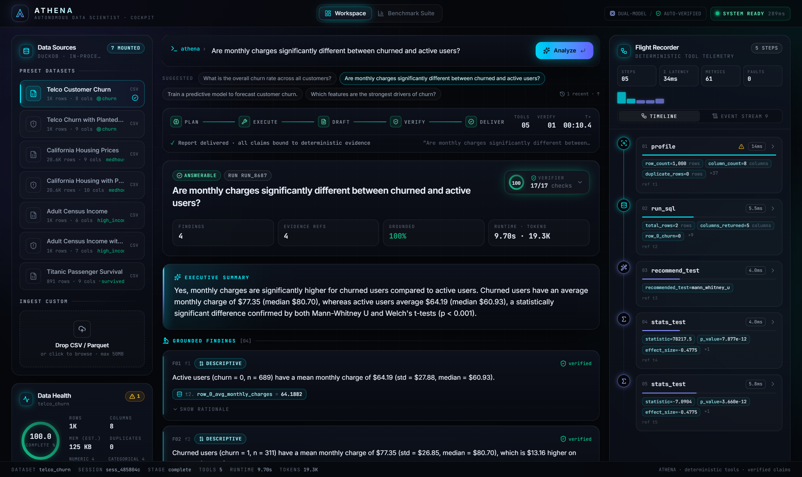
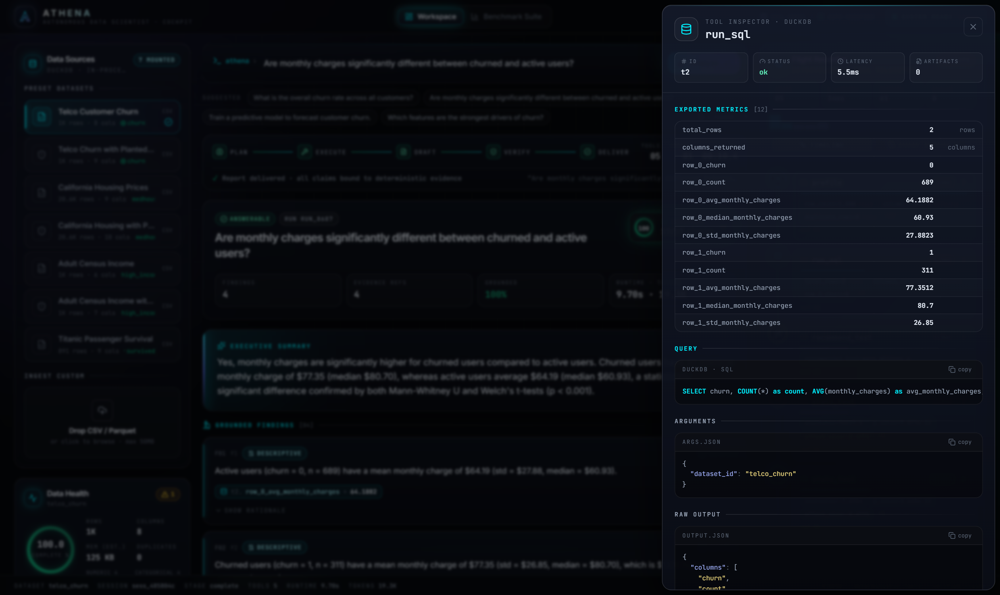
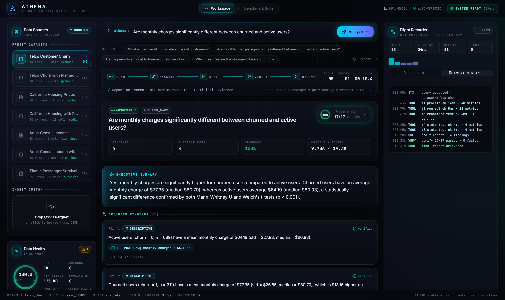
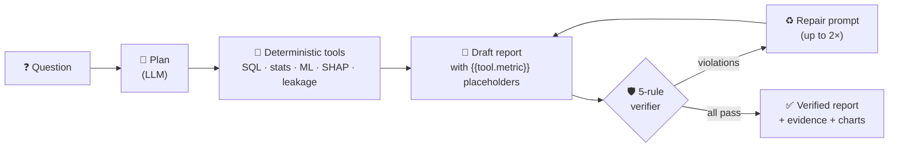
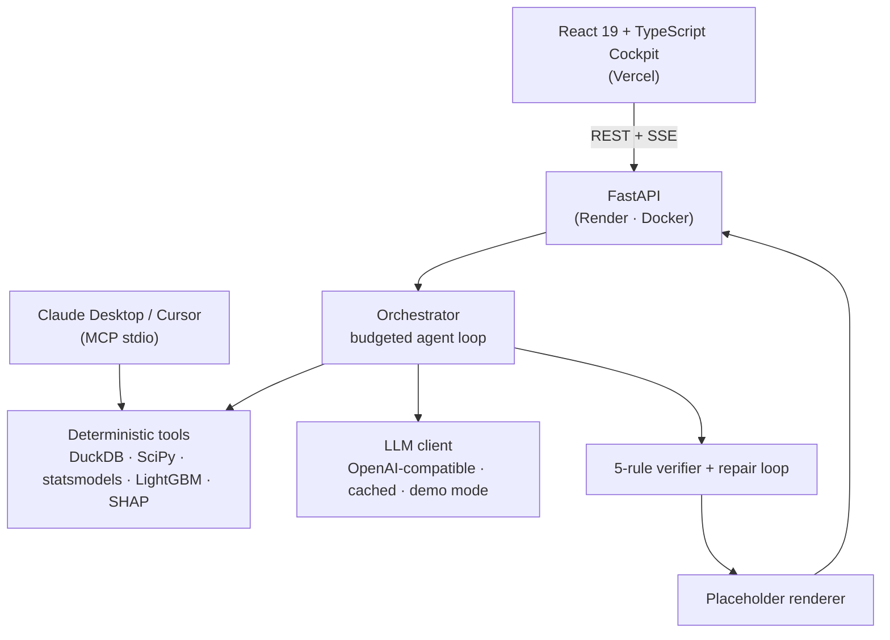

<div align="center">

# ◬ ATHENA

### The autonomous data scientist that **can't hallucinate a number**.

Ask a question in plain English. Athena plans the analysis, runs **real** SQL, statistics and ML,
then **mechanically verifies every claim** in its report against the tool outputs before you ever see it.

[](https://athena-cockpit.vercel.app)

[](https://github.com/YashNebhwani007/AthenaProject/actions)


[](LICENSE)

<br/>



<sub>A real run on the live deployment: 5 deterministic tool calls, 4 findings, **17/17 verifier checks passed**, every number traced to a tool result.</sub>

</div>

---

## The problem

Ask a general-purpose LLM *"are churned customers charged more?"* and you get a fluent, confident paragraph. The numbers may be invented, a correlation quietly becomes "causes", and the model happily trains on a column that leaks the answer. **You can't tell which sentences to trust**, so you re-do the analysis by hand.

## The idea

Athena splits the job in two, so the model never gets to guess:

| | Plain LLM / code interpreter | **Athena** |
|---|---|---|
| Where numbers come from | Generated text | **Deterministic tools** (DuckDB, SciPy, LightGBM, SHAP) |
| Is a claim checked? | No | **Every claim is verified** against tool output (±1% tolerance) |
| Correlation vs. causation | Slips through | **Causal-language trap** blocks unsupported causal verbs |
| Target leakage | Trains on it happily | **6-check leakage audit**, propagated into the report |
| Unanswerable questions | Makes something up | **Refuses**, and says what data is missing |
| Audit trail | None | **Every finding cites a tool run ID** you can open and inspect |

> The LLM is the *planner and writer*. It is never the *calculator*.

---

## The Cockpit

A mission-control UI built for the way analysts actually work: you watch the agent think, and you can inspect any step.

<table>
<tr>
<td width="50%"><br/><sub><b>Tool inspector.</b> Click any step or evidence chip to see the exact SQL, arguments, exported metrics and raw output.</sub></td>
<td width="50%"><br/><sub><b>Live flight recorder.</b> Every Server-Sent Event as it happens: tool calls, draft, verification, delivery.</sub></td>
</tr>
</table>

- **Streaming everything.** Tool results, the draft report and verifier passes arrive over SSE and animate in live.
- **Mission pipeline.** Plan → Execute → Draft → Verify → Deliver, with a running clock and counters.
- **Evidence chips.** Each finding links to the exact tool metric it relies on, with the value resolved inline.
- **Verifier audit.** Per-rule pass/fail breakdown, repair attempts, and unverified-claim count.
- **Dark glassmorphism + neon HUD**, keyboard-first (`Ctrl/⌘ + K`, `Esc` to abort, `↑` for history), responsive down to phones.
- **Charts** use a custom dark Plotly theme and are lazy-loaded, so the page stays fast.

---

## How a question flows



Findings are written with placeholders like `{{t2.row_1_avg_monthly_charges}}` that are **resolved from real tool output**, so a number the tools never produced simply can't appear.

### The 5-rule verifier

| Rule | What it enforces |
|---|---|
| **V1 Numeric grounding** | Any literal number in prose must match a cited metric within 1% relative / 0.005 absolute |
| **V2 Claim ↔ evidence** | "Significant" requires *p < α* after multiplicity correction; "higher/lower" must match the effect sign; "strong/weak" must match effect-size thresholds |
| **V3 Causal-language trap** | No *causes / leads to / due to* from observational data |
| **V4 Linkage** | Every finding cites a real tool run; every recommendation links back to findings |
| **V5 Data-quality propagation** | Severe leakage or missingness must be disclosed, never buried |

If repairs fail after the budget is spent, unverified claims are shown with a visible audit badge rather than silently passed through.

---

## Deterministic toolbox

| Tool | What it does |
|---|---|
| `profile` | Schema, missingness, duplicates, summary stats, quality warnings |
| `run_sql` | **AST-validated, read-only** DuckDB SQL (sqlglot) with automatic metric extraction |
| `recommend_test` | Checks assumptions and picks the right statistical test |
| `stats_test` | t-test, ANOVA, Mann-Whitney, χ², Fisher, Pearson/Spearman with effect sizes and multiplicity correction |
| `check_leakage` | 6 independent leakage checks (names, IDs, correlation, single-feature AUC, duplicates, temporal) |
| `train_model` | Leak-free pipelines, cross-validation, held-out evaluation, LightGBM + baselines |
| `explain_model` | Global and local SHAP explanations |
| `predict_model` | Out-of-sample scoring on new inputs |
| `make_plot` | Interactive Plotly + static chart artifacts |

---

## Quickstart

**Prerequisites:** Python 3.11+, Node 20+.

```bash
git clone https://github.com/YashNebhwani007/AthenaProject.git
cd AthenaProject
pip install -e ".[dev]"
```

Create a `.env` (any OpenAI-compatible endpoint works; Gemini shown):

```bash
ATHENA_LLM_PROVIDER=gemini
ATHENA_LLM_MODEL=gemini-flash-lite-latest
ATHENA_LLM_BASE_URL=https://generativelanguage.googleapis.com/v1beta/openai
ATHENA_LLM_API_KEY=your_key
```

Run the backend and the UI in two terminals:

```bash
python -m uvicorn athena.api.main:app --port 8000      # API  → http://127.0.0.1:8000/docs
npm --prefix frontend install && npm --prefix frontend run dev   # UI → http://localhost:5173
```

> **No API key?** Set `ATHENA_LLM_PROVIDER=demo` for a built-in scripted model, which is handy for exploring the UI.

Try these on the preset datasets:

- *"Are monthly charges significantly different between churned and active customers?"*
- *"Train a predictive model for churn and explain the top drivers."*
- Pick **Telco Churn with Planted Leakage**, ask for a model, and watch the leakage audit catch `cancellation_fee`.
- *"What's the weather tomorrow?"*, which Athena should refuse.

### Other entry points

```bash
python -m athena.cli profile benchmark/datasets/telco_churn.csv        # CLI
athena-mcp                                                             # MCP server (stdio)
pytest tests/ -v                                                       # 210 tests
python -m benchmark.runner --systems A1,A2,B1 --questions smoke        # benchmark
```

**Use it from Claude Desktop / Cursor** through MCP: see [`docs/mcp-usage.md`](docs/mcp-usage.md).

---

## Architecture



```
src/athena/
├── agent/       orchestrator, prompts, token/step budget
├── tools/       the 9 deterministic tools
├── verify/      verifier rules V1–V5, repair loop
├── render/      placeholder resolution → final report
├── llm/         provider clients, response cache, demo client
├── api/         FastAPI app, routes, SSE events
├── mcp_server/  MCP stdio server
├── sdk/         Python SDK
└── data/        dataset registry & loaders
frontend/src/    React cockpit (components, hooks, SSE client)
benchmark/       47-question evaluation suite with ground truth
```

---

## Engineering quality

- **210 automated tests**, run against real DuckDB instances and real DataFrames rather than mocks; only LLM calls are mocked or replayed.
- **Verifier rules each have positive and negative test cases.**
- **Ruff-clean** (`E`, `F`, `I`), strict typing, **Pydantic v2** schemas end to end.
- **CI** on every push (lint + tests on Python 3.11 and 3.12).
- **SQL sandbox:** only read-only statements pass AST validation; DuckDB runs with memory and time limits.
- **Multi-stage Docker build**, health checks, structured logging.
- **40 Architecture Decision Records** and 28 technical guides in [`docs/`](docs/).

### Benchmark harness

`benchmark/` ships a **47-question suite** over Telco churn, Adult income, California housing and Titanic (each with planted-leakage variants), with computed ground truth. It covers SQL, statistics, modeling, leakage detection, refusals, causal traps, prompt injection and multi-step questions, and compares three systems: **A1** (full Athena), **A2** (no verifier) and **B1** (plain LLM + code).

| Category | Questions | | Category | Questions |
|---|:-:|---|---|:-:|
| SQL | 13 | | Refusal | 4 |
| Statistics | 9 | | Causal trap | 3 |
| Modeling | 6 | | Prompt injection | 3 |
| Leakage | 6 | | Multi-step | 3 |

Scores depend on the model you plug in, so none are hard-coded here. Run `python -m benchmark.runner --systems A1,A2,B1 --questions all` and the **Benchmark Suite** tab in the cockpit renders the results.

---

## Deployment

| Piece | Where | Notes |
|---|---|---|
| UI | **Vercel** (`frontend/`) | Set `VITE_API_BASE` to the API origin |
| API | **Render** (`render.yaml`, Docker) | Also serves the built UI at its own URL |

The free Render tier sleeps when idle, so the first request after a quiet period can take 30 to 60 seconds. Full guide: [`docs/guides/production-docker-deployment.md`](docs/guides/production-docker-deployment.md).

---

<details>
<summary><b>📚 Architecture Decision Records & technical guides</b></summary>

<br/>

Every significant design choice is written up in [`docs/adr/`](docs/adr/) (index in [`docs/adr/README.md`](docs/adr/README.md)), including:
verification strategy ([ADR-01](docs/adr/adr-01-report-generation.md), [ADR-07](docs/adr/adr-07-verification.md)),
orchestrator control flow ([ADR-02](docs/adr/adr-02-orchestrator.md)),
SQL AST validation ([ADR-04](docs/adr/adr-04-sql-validation.md)),
statistical test selection ([ADR-06](docs/adr/adr-06-stats-test-selection.md)),
multiplicity control ([ADR-27](docs/adr/adr-27-fwer-and-fdr-multiplicity-control.md)),
SSE stream normalization ([ADR-20](docs/adr/adr-20-sse-stream-normalization.md)),
and the verifier's catastrophic-failure fallback ([ADR-40](docs/adr/adr-40-verifier-catastrophic-fallback.md)).

Hands-on guides in [`docs/guides/`](docs/guides/): [verifier rules](docs/guides/verifier-rules-specification.md), [leakage audit heuristics](docs/guides/data-leakage-audit-rules.md), [statistical test decision tree](docs/guides/statistical-test-decision-tree.md), [SHAP manual](docs/guides/shap-explainability-manual.md), [SQL security sandbox](docs/guides/sql-security-sandbox.md), [API reference](docs/guides/api-endpoint-reference.md), [MCP setup](docs/guides/mcp-setup-claude-desktop.md), [frontend architecture](docs/guides/frontend-architecture.md), and more.

</details>

---

<div align="center">

**Built by [Yash Nebhwani](https://github.com/YashNebhwani007)**: statistical rigor, automated verification, evidence-grounded insights.

⭐ If this is useful, a star helps others find it.

</div>
