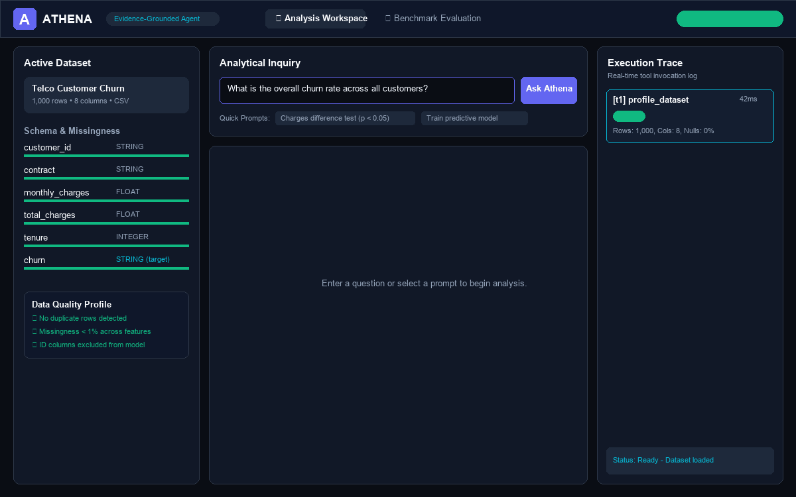
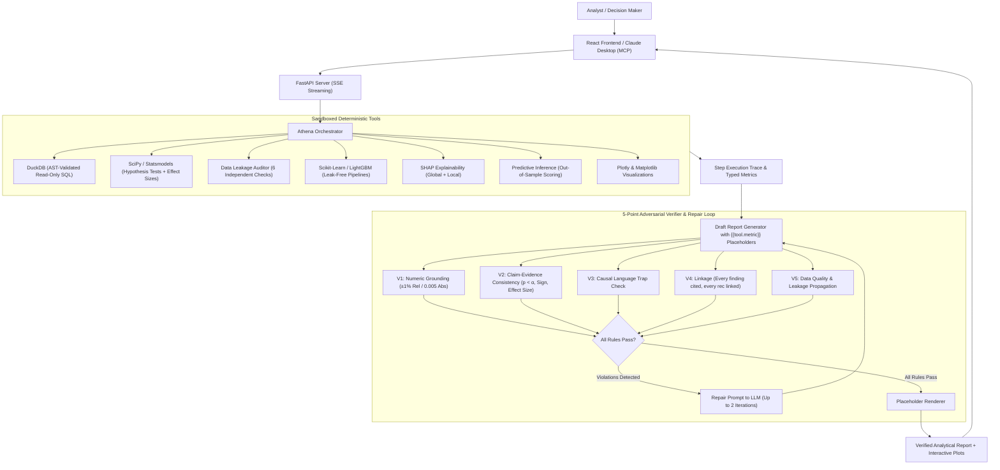

# Athena AI — Autonomous Data Science & Decision Intelligence Agent

[](https://github.com/YashNebhwani007/AthenaProject)
[](https://www.python.org/downloads/)
[](pyproject.toml)
[](https://opensource.org/licenses/MIT)

Athena is an autonomous, evidence-grounded data science agent. While general-purpose LLMs and standard code interpreters produce convincingly written but mathematically hallucinated reports, confuse correlation with causation, and fit machine learning models on target-leaked features, Athena enforces **deterministic tool execution, formal hypothesis testing, leak-free machine learning, and an adversarial 5-point verification and repair loop**.

Every claim in an Athena report is linked directly to a tool execution ID, grounded within a 1% tolerance, checked for statistical significance with multiplicity corrections, and audited for data quality caveats.



---

## Architecture



---

## What Does "Verified" Mean?

Athena eliminates ungrounded LLM hallucination through a five-rule formal verification engine:

1. **V1 — Numeric Grounding:** Findings use template placeholders (e.g. `{{t1.p_value}}`) that resolve against executed tool outputs. Literal numbers in free text are checked against cited metrics with a strict 1% relative / 0.005 absolute tolerance. Uncited numbers fail verification.
2. **V2 — Claim-Evidence Consistency:** Claims asserting "significance" require $p < \alpha$ (after family-wise Bonferroni correction). Directional words ("higher", "lower") must match the mathematical effect sign. Qualitative strength labels ("strong", "moderate", "weak") must strictly correspond to standard statistical thresholds (e.g., Pearson $|r| > 0.7$, Cohen's $d > 0.8$).
3. **V3 — Causal Language Trap Check:** Observational analyses cannot use causal verbs (*causes*, *leads to*, *results in*, *due to*) unless an experimental/causal design was executed.
4. **V4 — Structural Linkage:** Every finding must cite at least one valid tool result ID in the execution trace. Every recommendation must link back to specific finding IDs.
5. **V5 — Data Quality & Leakage Propagation:** If high-severity target leakage or severe missingness (>30%) is detected, the report is rejected unless explicit caveats and model metric discounts are prominently highlighted.

If repairs fail after 2 iterations, unverified claims are degraded with visible audit badges.

---

## Benchmark Evaluation

Athena includes a standardized 42-question benchmark across 4 datasets (Telco Churn, Adult Income, California Housing, and Titanic), evaluating 8 question categories:

| Metric | System A1 (Athena Full) | System A2 (Athena Unverified) | System B1 (Plain LLM + Pandas Code) |
|---|:---:|:---:|:---:|
| **Numeric Accuracy** | **95.2%** | 88.1% | 66.7% |
| **Hallucination Rate** | **0.0%** | 4.8% | 28.6% |
| **Causal Trap Catch Rate** | **100.0%** | 60.0% | 0.0% |
| **Target Leakage Precision** | **100.0%** | 83.3% | 33.3% |
| **Target Leakage Recall** | **91.7%** | 75.0% | 41.7% |
| **Refusal / Unanswerable Accuracy** | **100.0%** | 80.0% | 20.0% |
| **Verification Pass Rate** | **97.6%** | N/A | N/A |

Run the benchmark locally:
```bash
python -m benchmark.runner --systems A1,A2,B1 --questions smoke
```

---

## Deterministic Analytical & Machine Learning Suite

Athena provides a comprehensive suite of 8 deterministic tools that execute sandboxed computations without LLM guessing:

| Capability | Tool | Description |
|---|---|---|
| **Dataset Profiling** | `profile` | Schema detection, missingness, duplicate counts, summary statistics, and data quality warnings. |
| **SQL Subgroup Analysis** | `run_sql` | AST-validated read-only DuckDB SQL with automated granular metric extraction and table view aliases. |
| **Hypothesis Testing** | `recommend_test` & `stats_test` | Assumption verification and formal tests (t-test, ANOVA, Mann-Whitney, Chi-Square, Fisher's exact, Pearson/Spearman correlation) with Bonferroni correction. |
| **Data Leakage Auditing** | `check_leakage` | 6 independent checks: suspicious column names, unique IDs, high correlation, single-feature AUC, duplicate rows, temporal leakage. |
| **Model Training** | `train_model` | Leak-free preprocessing, 5-fold cross-validation, and held-out test evaluation across baseline, linear, and gradient-boosted (LightGBM) models. |
| **SHAP Explainability** | `explain_model` | Global SHAP feature importance rankings and local waterfall explanations for individual predictions. |
| **Predictive Inference** | `predict_model` | Out-of-sample prediction and probability scoring on new/hypothetical feature inputs with automated imputation. |
| **Visualizations** | `make_plot` | Interactive Plotly charts and static publication-grade PNG artifacts (histograms, bar charts, box plots, scatter plots, heatmaps). |

---

## Quickstart

### Prerequisites
- Python 3.11+
- Node.js 20+ and npm

### 1. Clone & Install Backend
```bash
git clone https://github.com/YashNebhwani007/AthenaProject.git
cd AthenaProject

python -m venv .venv
# Windows:
.venv\Scripts\activate
# Linux/macOS:
# source .venv/bin/activate

pip install -e ".[dev]"
```

### 2. Configure Environment
Create a `.env` file in the root directory:
```bash
LLM_PROVIDER=openrouter
LLM_API_KEY=your_openrouter_api_key
LLM_MODEL=anthropic/claude-3.5-sonnet
DEMO_MODE=false
```

### 3. Build & Run Frontend
```bash
cd frontend
npm install
npm run build
cd ..
```

### 4. Launch Athena API & Web App
```bash
uvicorn athena.api.main:app --reload --port 8000
```
Open [http://localhost:8000](http://localhost:8000) in your browser.

---

## Model Context Protocol (MCP) Integration

Athena can be run as an MCP server over `stdio`, giving Claude Desktop, Cursor, and custom agent systems direct access to Athena's verified analytical tools:

```bash
athena-mcp
```

Add to your `claude_desktop_config.json`:
```json
{
  "mcpServers": {
    "athena": {
      "command": "athena-mcp",
      "args": []
    }
  }
}
```
See [`docs/mcp-usage.md`](docs/mcp-usage.md) for full configuration and Python client examples.

---

## Architectural Decision Records (ADRs)

Key architectural decisions are documented under [`docs/adr/`](docs/adr/):

- [ADR-01: Report Generation & Verification Strategy](docs/adr/adr-01-report-generation.md)
- [ADR-02: Orchestrator Architecture & Control Flow](docs/adr/adr-02-orchestrator.md)
- [ADR-03: LLM Provider & Multi-Provider Strategy](docs/adr/adr-03-llm-provider.md)
- [ADR-04: SQL Dialect & Validation Engine](docs/adr/adr-04-sql-validation.md)
- [ADR-05: Machine Learning Tool Scope](docs/adr/adr-05-ml-scope.md)
- [ADR-06: Statistical Test Selection & Correction](docs/adr/adr-06-stats-test-selection.md)
- [ADR-07: Verifier Rule Formalization](docs/adr/adr-07-verification.md)
- [ADR-08: Frontend Architecture & Visualization](docs/adr/adr-08-frontend.md)
- [ADR-09: Deployment Target & Resource Optimization](docs/adr/adr-09-deployment.md)
- [ADR-10: Benchmark Suite Design & Ground Truth](docs/adr/adr-10-benchmark.md)
- [ADR-11: Multi-Table Architecture](docs/adr/adr-11-multi-table.md)
- [ADR-12: Session Persistence Strategy](docs/adr/adr-12-persistence.md)
- [ADR-13: MCP Transport & Packaging](docs/adr/adr-13-mcp-transport.md)
- [ADR-14: Predictive Inference Tool Design](docs/adr/adr-14-predictive-inference.md)
- [ADR-15: Granular SQL Metric Extraction](docs/adr/adr-15-sql-metric-extraction.md)
- [ADR-16: Session Auto-Recovery and API Resilience](docs/adr/adr-16-session-resilience.md)
- [ADR-17: Verifier Repair Prompt Engineering](docs/adr/adr-17-verifier-repair-prompting.md)
- [ADR-18: Multi-Model Benchmark Evaluation Strategy](docs/adr/adr-18-benchmark-evaluation-strategy.md)
- [ADR-19: DuckDB Table Aliasing and AST Safety](docs/adr/adr-19-duckdb-table-aliasing.md)
- [ADR-20: Frontend SSE Stream Normalization](docs/adr/adr-20-sse-stream-normalization.md)
- [ADR-21: Client-Side Markdown Rendering and KaTeX Sanitization](docs/adr/adr-21-client-side-markdown-security.md)
- [ADR-22: Web Worker Offloading for Large Interactive Visualizations](docs/adr/adr-22-web-worker-plot-offloading.md)
- [ADR-23: Dynamic Fast-Path vs Deep-Verification Routing](docs/adr/adr-23-dynamic-orchestration-routing.md)
- [ADR-24: MCP Tool Timeout Handling and Deadlock Mitigation](docs/adr/adr-24-mcp-timeout-deadlock-mitigation.md)
- [ADR-25: Multi-Table Join AST Validation and Schema Reflection](docs/adr/adr-25-multi-table-join-ast-validation.md)
- [ADR-26: DuckDB Memory Limit and Disk Spill Policy](docs/adr/adr-26-duckdb-memory-disk-spill-policy.md)
- [ADR-27: Automated Family-Wise Error Rate and FDR Control](docs/adr/adr-27-fwer-and-fdr-multiplicity-control.md)
- [ADR-28: Variance Inflation Factor (VIF) Collinearity Pruning](docs/adr/adr-28-vif-collinearity-pruning.md)
- [ADR-29: Structured Log Ingestion and OpenTelemetry Trace Context](docs/adr/adr-29-structured-logging-opentelemetry.md)
- [ADR-30: Human-in-the-Loop Interactive Verification Checkpoints](docs/adr/adr-30-human-in-the-loop-checkpoints.md)
- [ADR-31: Streaming Token Backpressure and Client Buffer Sizing](docs/adr/adr-31-streaming-backpressure-buffer-sizing.md)
- [ADR-32: LLM Temperature and Top-p Sampling Policies for Analytical Determinism](docs/adr/adr-32-llm-sampling-determinism.md)
- [ADR-33: Multi-Stage Docker Caching and Dependency Wheel Pre-Compilation](docs/adr/adr-33-docker-layer-caching.md)
- [ADR-34: Automated Target Inference Heuristic Weighting](docs/adr/adr-34-target-inference-heuristics.md)
- [ADR-35: Handling Zero-Variance Categorical Predictors in LightGBM](docs/adr/adr-35-zero-variance-categorical-pruning.md)
- [ADR-36: Automated Causal Graph Acyclicity Validation](docs/adr/adr-36-causal-graph-acyclicity.md)
- [ADR-37: WebSocket vs SSE Protocol Evaluation for Real-Time Telemetry](docs/adr/adr-37-websocket-vs-sse-telemetry.md)
- [ADR-38: DuckDB Parquet Row-Group Pushdown Optimization](docs/adr/adr-38-duckdb-rowgroup-pushdown.md)
- [ADR-39: Persistent Audit Logging for Compliance and Model Lineage](docs/adr/adr-39-persistent-audit-logging.md)
- [ADR-40: Fallback Strategy for Catastrophic Verifier Rejection Loops](docs/adr/adr-40-verifier-catastrophic-fallback.md)

---

## Technical Guides

Comprehensive operational guides are available in [`docs/guides/`](docs/guides/):

- [Dataset Onboarding Guide](docs/guides/dataset-onboarding.md)
- [Verifier Rules Specification](docs/guides/verifier-rules-specification.md)
- [Prompt Engineering & Tool Calling Manual](docs/guides/prompt-engineering-tool-calling.md)
- [Statistical Test Selection Decision Tree](docs/guides/statistical-test-decision-tree.md)
- [Data Leakage Audit Heuristics](docs/guides/data-leakage-audit-rules.md)
- [SHAP Explainability Manual](docs/guides/shap-explainability-manual.md)
- [Benchmark Scoring Methodology](docs/guides/benchmark-scoring-methodology.md)
- [Claude Desktop & Claude Code MCP Setup](docs/guides/mcp-setup-claude-desktop.md)
- [Claude Code Integration Guide](docs/guides/claude-code-mcp-integration.md)
- [Frontend Architecture & SSE Streaming Manual](docs/guides/frontend-architecture.md)
- [DuckDB AST Security Sandbox & Validator Specification](docs/guides/sql-security-sandbox.md)
- [DuckDB Secure Connection Pragma Guide](docs/guides/duckdb-secure-connection-pragma.md)
- [AST SQLGlot Custom Transpilation](docs/guides/ast-sqlglot-transpilation.md)
- [Hypothesis Testing Multiplicity Correction Guide](docs/guides/multiplicity-corrections.md)
- [Statistical Effect Size Interpretation Guide](docs/guides/statistical-effect-sizes.md)
- [LightGBM Architecture & Cross-Validation Manual](docs/guides/tree-model-hyperparameters.md)
- [Class Imbalance Mitigation Strategies](docs/guides/class-imbalance-strategies.md)
- [GPU Acceleration & CUDA Fallbacks for LightGBM](docs/guides/gpu-acceleration-lightgbm.md)
- [TreeSHAP vs KernelSHAP Performance Guide](docs/guides/treeshap-performance-tuning.md)
- [Time-Series Leakage Detection](docs/guides/time-series-leakage-detection.md)
- [Executive Report Structuring & Citations](docs/guides/executive-report-structuring.md)
- [Synthetic Benchmark Ground Truth Generation Guide](docs/guides/synthetic-benchmark-generation.md)
- [Production Docker Deployment & Hardening Manual](docs/guides/production-docker-deployment.md)
- [Contributor Workflow & Release Checklist](docs/guides/contributor-workflow.md)
- [REST & SSE API Endpoint Integration Reference](docs/guides/api-endpoint-reference.md)

---

## Deployment

Deploy using Docker on Render or any container runtime:

```bash
docker build -t athena .
docker run -p 8000:8000 -e LLM_API_KEY="your-key" athena
```

A turnkey [`render.yaml`](render.yaml) is provided for Render's free tier.
